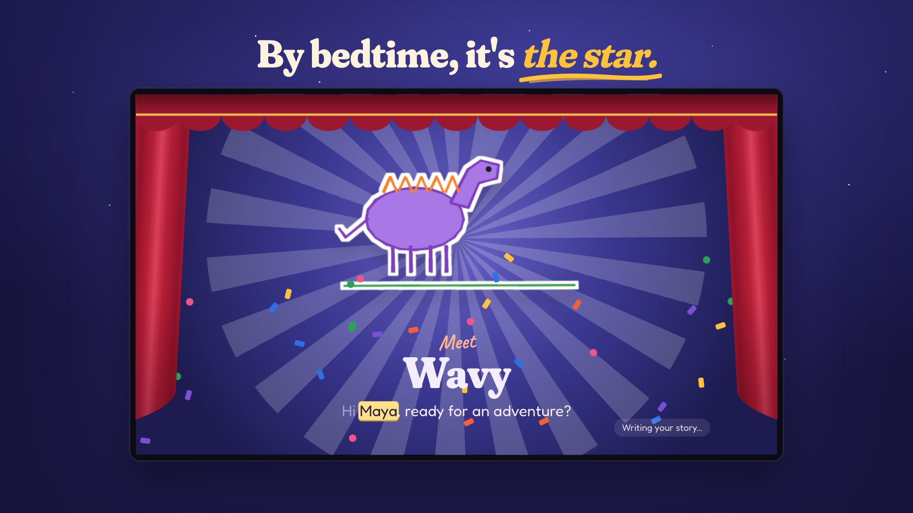
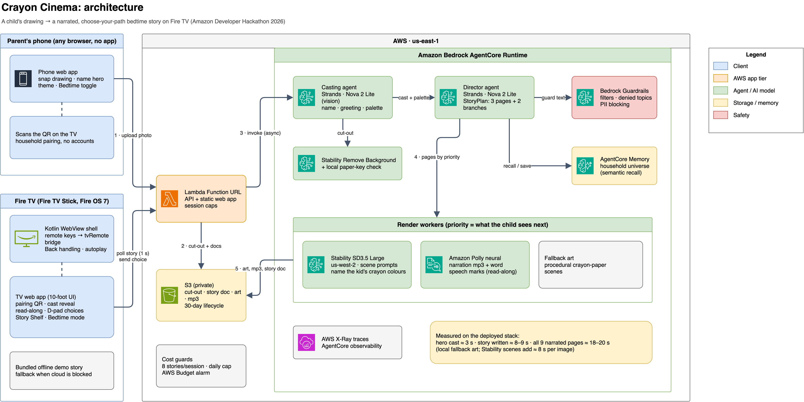
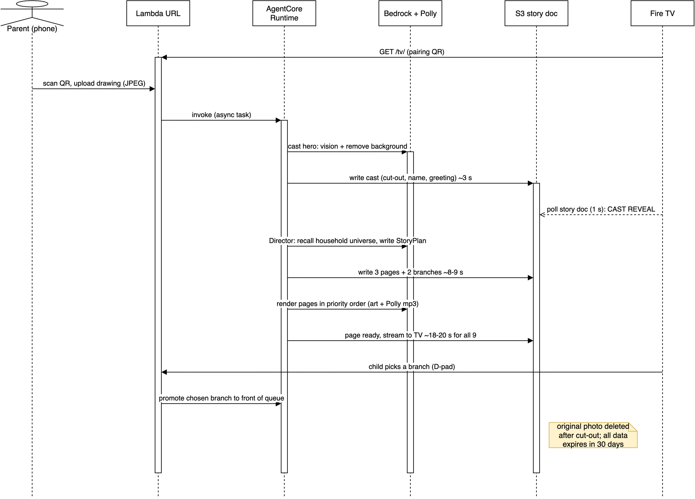

# Crayon Cinema

**Tonight's bedtime story stars whatever your child drew today.**

A child draws a hero on paper. A parent snaps a photo with their phone. Within seconds the drawing jumps off the page on the Fire TV, introduces itself in a child's voice, and stars in a narrated picture-book story with read-along words. The kids pick what happens next with the remote. Every hero is saved to the family's Story Shelf and can come back in future stories.

Built for the **Amazon Developer Hackathon 2026, Fire TV track**. It also enters the AWS Builder and Open Source mini challenges.

> Live web build: <https://e7szjoxoeoyy3fwly4nyzjv2e40djaoh.lambda-url.us-east-1.on.aws/tv/> (arrow keys and Enter act as the remote; scan the QR with a phone)
> Demo video: [`docs/media/crayon-cinema-pitch.mp4`](docs/media/crayon-cinema-pitch.mp4) · Devpost: _link_ · Open-source kit: [`oss/firetv-webview-kit`](oss/firetv-webview-kit)

[](docs/media/crayon-cinema-pitch.mp4)

---

## Why it matters

Screen time at bedtime usually means passive watching. Crayon Cinema turns the biggest screen in the house into a reward for making something:

- **Creative:** the child's own art is the star, not a licensed character.
- **Literacy:** narration with word-by-word highlighting builds reading confidence.
- **Shared:** it's a lean-back family moment; one parent's phone and one remote.
- **Calming:** Bedtime mode slows the narration, uses darker colours and ends with the hero falling asleep.

## How it works



*Editable source: [`docs/architecture.drawio`](docs/architecture.drawio). The PNG has the diagram embedded, so you can also open it directly in [draw.io](https://app.diagrams.net).*

**Story flow, from QR scan to the child's first choice:**



*Editable source: [`docs/story-flow.drawio`](docs/story-flow.drawio).*

**Latency design.**
- The cast reveal (cut-out, name, greeting) arrives first, which hides the story writing behind a moment of delight.
- Pages stream to the TV as each one finishes.
- When the child picks a branch, it jumps to the front of the render queue.
- Measured on the deployed stack (Lambda + AgentCore, us-east-1): the hero is cast about 3 s after the upload, the story is written by about 8–9 s, and all 9 narrated pages are ready 18–20 s after the phone upload. Timings are saved per story in `timings`. (Measured with local fallback art; with Stability scenes, add about 8 s per image, 2 in parallel, in priority order.)

**Look and feel.** The TV UI is a paper-craft picture-book theatre: a ticket-style pairing card, a marquee, a polaroid Story Shelf, a film-strip progress bar and a curtain reveal. Display type is Fraunces, handwriting is Caveat and body text is Fredoka. Only transforms and opacity are animated, which keeps playback smooth on stick hardware.

**Why the art looks like the child's.** The hero *is* the child's drawing, cut out of the paper. Every scene prompt names the crayon colours found in the cut-out, so each world matches its hero. (This was built on Nova Canvas colour-guided generation, which has since reached end of life; see the friction log.)

## Repository

| Path | What |
|---|---|
| `firetv-app/` | Fire TV app (Kotlin WebView shell). Remote-key bridge, Back handling, autoplay, bundled offline sample, LAN dev mode. |
| `web/tv/` | The 10-foot TV app: pairing QR, cast reveal, read-along player, D-pad choices, Story Shelf, Bedtime mode. |
| `web/phone/` | Phone companion page: snap, name, theme, bedtime. No app install needed. |
| `web/shared/` | Spatial navigation (`tv-focus.js`), remote normalisation, API client, Fraunces, Caveat and Fredoka fonts (OFL). |
| `backend/crayon/` | Pipeline, Strands agents, AWS wrappers, storage, HTTP router. Runs in the dev server, Lambda and AgentCore. |
| `backend/agentcore_app.py` | AgentCore Runtime entry point (async task). |
| `backend/lambda_handler.py` | Lambda Function URL entry point. |
| `infra/` | One-command, idempotent boto3 deployment (S3, Guardrail, IAM, Lambda URL, Budget) and AgentCore deployment. |
| `oss/firetv-webview-kit/` | MIT open-source kit extracted from this project (Open Source mini challenge). |
| `scripts/` | Model probe (`list_models.py`), demo export, Fire TV helper (`firetv.sh`), brand asset generators. |
| `docs/` | Architecture and story-flow diagrams (draw.io), feedback, friction log, Devpost text, demo script, store art. |

## Run it locally (no AWS needed)

```bash
# Python 3.12 (uv recommended)
uv venv --python 3.12 .venv && uv pip install --python .venv/bin/python -r backend/requirements.txt pytest
cp .env.example .env                    # CRAYON_MODE=mock by default
.venv/bin/python backend/dev_server.py  # prints http://<your-ip>:8787/tv/
```

Open the TV URL in a desktop browser (arrow keys and Enter act as the remote). Scan the QR code with a phone on the same Wi-Fi.

In mock mode the app uses placeholder backgrounds, a template story and timed highlighting, so you can work on the UI offline.

## Run it on a Fire TV

Verified on a **Fire TV Stick (AFTSS), Fire OS 7.7.1.7, Amazon WebView 138**. A prebuilt release APK pointing at the cloud build is produced by the Gradle step below (`dist/crayon-cinema-firetv.apk`, not committed).

1. Enable **Developer options → ADB debugging** on the Fire TV. To reveal Developer options, go to **Settings → My Fire TV → About** and select the device name 7 times.
2. Build and install:
   ```bash
   scripts/firetv.sh connect <fire-tv-ip>
   scripts/firetv.sh install
   scripts/firetv.sh dev        # point the app at this Mac's dev server and launch it
   ```
3. For the cloud version, build with the deployed URL:
   ```bash
   cd firetv-app && ./gradlew assembleRelease -PcrayonUrl=https://<function-url>/tv/
   ```
   CI also builds the APK on every push and attaches it to tagged releases.

## Deploy to AWS

```bash
# .env: AWS credentials, AWS_REGION=us-east-1, CRAYON_MODE=aws, optional BUDGET_EMAIL
.venv/bin/python scripts/list_models.py          # sends one tiny request to each configured model
.venv/bin/python infra/deploy.py                 # bucket, guardrail, IAM, Lambda + public URL
.venv/bin/python infra/deploy_agentcore.py       # AgentCore Runtime + Memory
# add the printed AGENTCORE_* values to .env, then
.venv/bin/python infra/deploy.py --skip-build
```

Models:
- **Text and vision (agents):** Amazon Nova 2 Lite (`us.amazon.nova-2-lite-v1:0`) is first-party, so it needs no Marketplace subscription. Any Bedrock Converse model with vision and tool use can replace it through `STORY_MODEL_ID` and `CASTING_MODEL_ID`.
- **Images:** Stability AI on Bedrock. Stable Image Remove Background runs in `us-east-1`; SD3.5 Large is served from `us-west-2` (`SCENE_REGION`). Both are sold through AWS Marketplace, so **the AWS account needs a valid payment method**.
- Without image access, the app still works: it uses a local paper-key cut-out and procedural crayon-paper scenes.

## Safety and privacy (it's for kids)

- Every model input and output that reaches a child passes through **Bedrock Guardrails**: content filters at HIGH, denied topics (scary content, personal details) and PII blocking. Blocked or failed generations fall back to a safe template story.
- The **original photo is deleted** as soon as the hero is cut out. Only the cut-out and the generated story are kept. Everything expires after **30 days** (S3 lifecycle).
- The app only asks for a **first name**, and it is sanitised. There are no accounts and no ads, and nothing is shared outside the family.
- Cost guards: 8 stories per session, a daily global cap, and an optional AWS Budget alarm.

## Tests

```bash
.venv/bin/python -m pytest backend/tests -q            # pipeline, API, Polly offset mapping, Lambda events
node --test oss/firetv-webview-kit/test/tv-focus.test.js
```

## Editing the diagrams

The `.drawio` files are the source of truth. To re-export after editing in draw.io:

```bash
drawio -x -f png -e -s 2 -o docs/architecture.drawio.png docs/architecture.drawio
drawio -x -f png -e -s 2 -o docs/story-flow.drawio.png docs/story-flow.drawio
```

## License

MIT, see [LICENSE](LICENSE). The Fraunces, Caveat and Fredoka fonts are under the SIL Open Font License (`web/shared/fonts/OFL*.txt`). All sound effects are generated with WebAudio, and all art is generated or drawn for this project.
